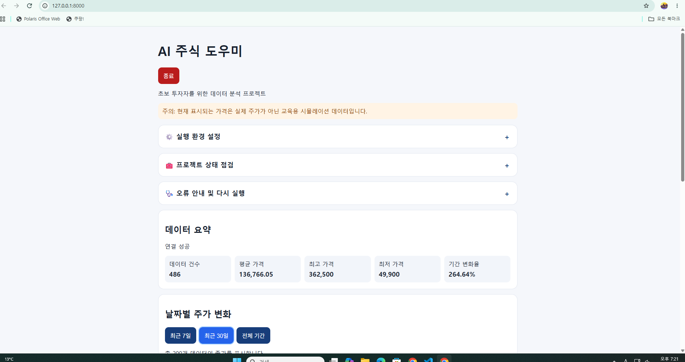
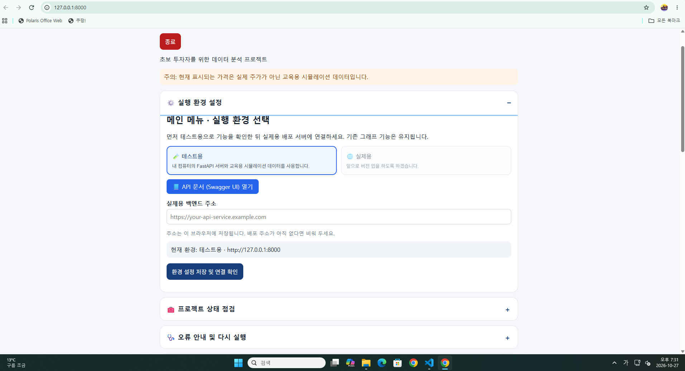
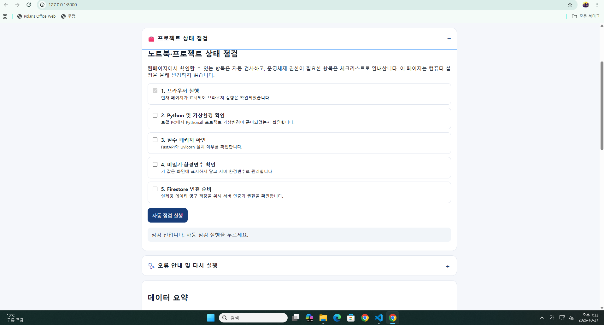
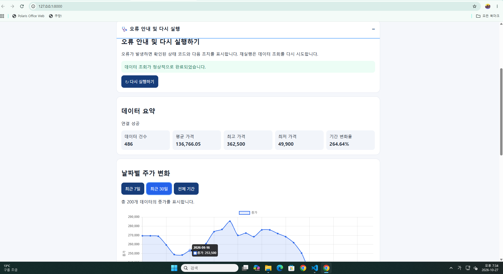
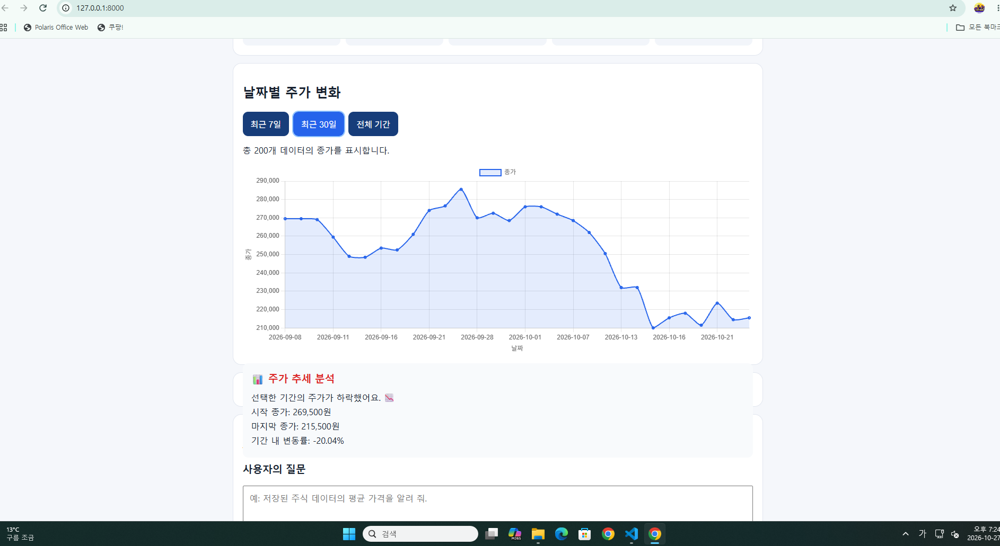
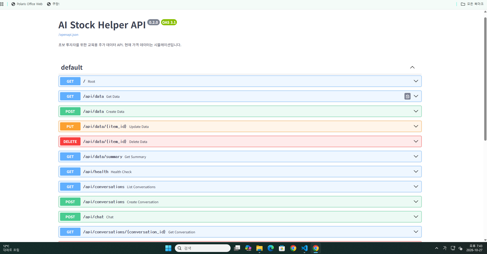
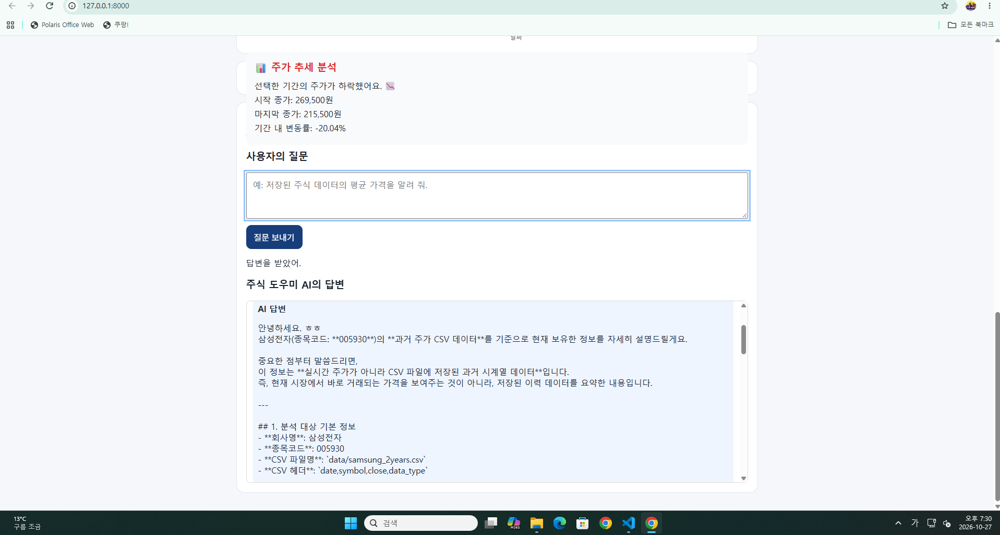
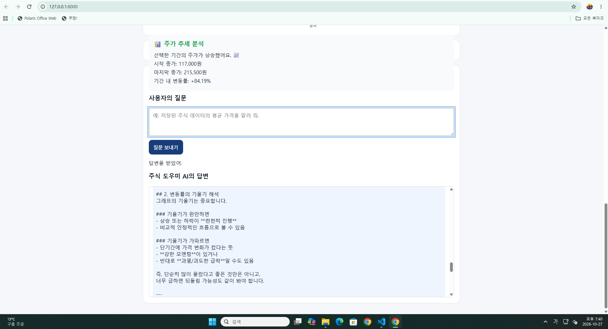

<h1 align="center">AI 주식 도우미</h1>
<p align="right"><strong>과제 제출자 : 신재풍</strong></p>

초보자가 주식 시계열 데이터를 조회하고, 요약 통계와 그래프를 통해 가격의 변화를 살펴보며, AI 채팅으로 데이터에 관한 질문을 할 수 있도록 만든 교육용 웹 프로젝트입니다.

## 1. 주식 데이터 안내

이 프로젝트는 날짜별 주식 가격 데이터를 사용하여 데이터 조회, 요약, 그래프 표시 및 AI 채팅 기능을 제공합니다.

### 데이터 이용 시 주의사항

- 테스트용 환경에서는 교육용 시뮬레이션 데이터를 사용합니다.
- 데이터의 출처와 환경에 따라 표시되는 내용이 달라질 수 있습니다.
- 과거 주가 데이터는 미래의 주가를 보장하지 않습니다.
- AI의 답변은 참고용 설명이며, 실제 투자 판단을 대신하지 않습니다.

## 2. 대시보드 사용 방법

대시보드에는 실행 환경 선택, 연결 확인, 상태 점검, 데이터 요약, 주가 그래프, 
API 응답 및 AI 채팅 기능이 구성되어 있습니다.



### 2-1. 실행 환경 선택

- **테스트용:** 내 컴퓨터에서 실행하는 FastAPI 서버에 연결합니다.
- **실제용:** 배포된 백엔드 서버에 연결합니다.
- **실제용 백엔드 주소:** 배포 서버의 주소를 입력합니다.
- **환경 설정 저장 및 연결 확인:** 설정한 환경과 백엔드의 연결 상태를 확인합니다.
실제용 환경을 선택했다고 해서 실제 시장 가격이 자동으로 제공되는 것은 아닙니다.  
실제 데이터의 출처와 백엔드 구현 상태를 확인해야 합니다.



### 2-2. 프로젝트 상태 점검

대시보드의 체크리스트는 브라우저에서 확인할 수 있는 항목과 사용자가 직접 확인해야 하는 항목을 구분합니다.

- **자동 점검 실행:** 페이지에서 확인할 수 있는 항목을 검사합니다.
- **사용자 체크리스트:** Python 설치, 비밀키·환경변수, Firestore 연결 등 사용자가 확인해야 하는 사항을 안내합니다.
- **오류 안내 및 다시 실행하기:** 표시된 오류를 확인하고 데이터 조회를 다시 시도할 수 있습니다.
브라우저가 운영체제의 설정이나 로컬 패키지를 직접 설치하거나 변경하지는 않습니다.




### 2-3. 데이터 요약 및 주가 그래프

- **데이터 요약:** 백엔드에서 받은 데이터의 요약 정보를 확인합니다.
- **최근 7일:** 최근 7개 데이터의 종가 변화를 살펴봅니다.
- **최근 30일:** 최근 30개 데이터의 종가 변화를 살펴봅니다.
- **전체 기간:** 제공된 데이터 전체의 가격 변화를 확인합니다.
- **데이터 다시 불러오기:** 백엔드에서 데이터를 다시 요청합니다.

그래프에는 날짜별 종가가 표시되며, 선택한 기간의 시작 종가와 마지막 종가를 비교하여 변동률과 추세를 확인할 수 있습니다.



### 2-4. API 응답

대시보드의 API 응답 영역에서는 백엔드에서 반환한 데이터를 확인할 수 있습니다.

**Swagger API 문서 열기**를 누르면 API 문서 화면으로 이동하여 API의 요청 형식과 응답 결과를 확인할 수 있습니다.

 
### 2-5. 대시보드 이용 순서

1. 테스트용 또는 실제용 환경을 선택합니다.
2. 백엔드 주소를 확인하고 연결을 점검합니다.
3. 상태 점검과 사용자 체크리스트를 확인합니다.
4. 데이터 요약과 주가 그래프를 살펴봅니다.
5. 필요한 경우 데이터를 다시 불러옵니다.
6. AI 채팅에 질문을 입력합니다.

각 기능은 화면에 표시된 버튼을 눌러 실행합니다. 연결 상태와 기능 구현에 따라 실행 결과가 달라질 수 있습니다.


## 3. 배포 및 접속 방법

### 배포된 서비스

- **백엔드 서버:** https://codysseym1-2-qwn4.onrender.com
- **Swagger API 문서:** https://codysseym1-2-qwn4.onrender.com/docs

배포 서버와 API 문서에 접속하여 서비스가 제공하는 기능을 확인할 수 있습니다.

### 배포 버튼 안내

배포 플랫폼의 배포 기능은 프로젝트 코드를 서버에 반영하는 데 사용됩니다.   
자동 배포 여부와 배포 완료 상태는 저장소 연결 및 배포 플랫폼 설정에 따라 달라질 수 있습니다.

1. 저장소에 반영할 코드를 확인합니다.
2. 배포 플랫폼에서 해당 서비스와 배포 설정을 확인합니다.
3. 필요한 경우 배포를 실행합니다.
4. 배포 완료 후 서비스 주소와 주요 API를 확인합니다.

배포가 완료되었다는 표시만으로 모든 기능의 정상 작동이 보장되는 것은 아닙니다.   
실제 접속과 기능 실행 결과를 확인해야 합니다.

## 4. Swagger API 사용 설명

Swagger UI는 서버가 제공하는 API 목록과 요청·응답 형식을 확인하고,   
브라우저에서 API를 직접 실행할 수 있도록 제공되는 문서 화면입니다.



**접속 주소:**  
https://codysseym1-2-qwn4.onrender.com/docs

### 4-1. API 항목과 한글 설명

| 순서 | API 항목 | 한글 설명 |
|---:|---|---|
| 1 | `GET /` | 기본 경로 확인 |
| 2 | `GET /api/data` | 주식 데이터 조회 |
| 3 | `POST /api/data` | 주식 데이터 추가 |
| 4 | `PUT /api/data/{item_id}` | 주식 데이터 수정 |
| 5 | `DELETE /api/data/{item_id}` | 주식 데이터 삭제 |
| 6 | `GET /api/data/summary` | 주식 데이터 요약 |
| 7 | `GET /api/health` | 서버 상태 확인 |
| 8 | `GET /api/conversations` | 대화 목록 조회 |
| 9 | `POST /api/conversations` | 새 대화 생성 |
| 10 | `POST /api/chat` | AI 채팅 |
| 11 | `GET /api/conversations/{conversation_id}` | 특정 대화 조회 |
| 12 | `DELETE /api/conversations/{conversation_id}` | 특정 대화 삭제 |
| 13 | `POST /api/shutdown-token` | 서버 종료용 토큰 발급 |
| 14 | `POST /api/shutdown` | 서버 종료 |

위 표는 Swagger 화면에 표시된 API 항목을 한글로 설명한 것입니다.  
항목이 표시된다는 사실만으로 모든 기능이 실제용 환경에서 정상 작동한다고 보장하지는 않습니다.

### 4-2. API 실행 방법

1. Swagger UI에 접속합니다.
2. 실행하려는 API 항목을 눌러 펼칩니다.
3. `Try it out`을 눌러 요청 입력을 준비합니다.
4. 필요한 입력값을 작성합니다.
5. `Execute`를 눌러 요청을 실행합니다.
6. 응답 상태 코드와 반환 데이터를 확인합니다.

### 4-3. 주요 영어 용어

| 영어 항목 | 한글 설명 |
|---|---|
| `Parameters` | 요청에 필요한 입력값 |
| `Request body` | 서버에 전달하는 데이터 |
| `Try it out` | API 실행 준비 |
| `Execute` | API 요청 실행 |
| `Responses` | 서버 응답 결과 |
| `Response body` | 서버가 반환한 데이터 |
| `Code` | HTTP 응답 상태 코드 |
| `Schemas` | API에서 사용하는 데이터 구조 |

### 4-4. 실행 시 주의사항

- 데이터 추가·수정·삭제 API는 실제 데이터에 영향을 줄 수 있으므로 주의해서 실행합니다.
- 서버 종료 관련 API는 일반적인 기능 확인 과정에서 실행하지 않습니다.
- 실제용 백엔드 연결이 미비한 기능은 요청이 실패하거나 기대한 결과를 반환하지 않을 수 있습니다.
- 연결이 완료되지 않은 기능은 실제용 연동이 필요하다는 점을 구분하여 설명합니다.


## 5. AI 채팅 사용 방법

AI 채팅은 사용자가 자연어로 질문을 입력하고, 서버가 제공하는 AI 채팅 API를 통해 답변을 받는 기능입니다.




### 5-1. 질문 입력하기

1. 대시보드의 **AI 주식 도우미에게 질문하기** 영역으로 이동합니다.
2. 질문 입력란에 궁금한 내용을 작성합니다.
3. **질문 보내기**를 누릅니다.
4. 답변 작성 중 표시를 확인하고 결과를 읽습니다.

### 5-2. 질문 예시

- 저장된 주식 데이터의 전체 건수를 알려 줘.
- 데이터의 첫 날짜와 마지막 날짜를 알려 줘.
- 선택한 기간의 주가 추세를 설명해 줘.
- 평균 종가와 최고·최저 종가를 설명해 줘.

실제로 제공되는 데이터와 AI 채팅 기능의 연결 상태에 따라 답변 가능한 내용이 달라질 수 있습니다.

### 5-3. AI 답변 이용 시 주의사항

- AI 답변은 제공된 데이터와 질문 내용에 따라 달라질 수 있습니다.
- 답변에 포함된 숫자와 날짜는 데이터 조회 결과와 비교하여 확인합니다.
- AI가 설명한 추세는 미래 주가를 예측하거나 보장하는 의미가 아닙니다.
- API 키 등 비밀정보를 질문 입력란에 작성하지 않습니다.
- AI 채팅이 실제용 환경에서 정상적으로 연결되는지 확인한 뒤 사용합니다.

## 6. 로컬 개발 환경 설정

### 6-1. 준비 사항

- Python 3.10 이상 권장
- 프로젝트 소스 코드
- `requirements.txt`에 명시된 패키지

### 6-2. Python 버전 확인

PowerShell에서 프로젝트 폴더로 이동한 뒤 실행합니다.

```powershell
python --version
```

### 6-3. 가상환경 생성 및 패키지 설치

```powershell
python -m venv .venv
.\.venv\Scripts\Activate.ps1
python -m pip install -r requirements.txt
```

가상환경 활성화가 차단되면 가상환경의 Python을 직접 사용할 수 있습니다.

```powershell
.\.venv\Scripts\python.exe -m pip install -r requirements.txt
```

### 6-4. 서버 실행

```powershell
python -m uvicorn app.main:app --reload
```

서버가 실행 중인 터미널은 닫지 않습니다.

### 6-5. 로컬 접속 주소

- 메인 화면: http://127.0.0.1:8000/
- Swagger API 문서: http://127.0.0.1:8000/docs
- 서버 상태: http://127.0.0.1:8000/api/health
- 데이터 요약: http://127.0.0.1:8000/api/data/summary
- 주식 데이터: http://127.0.0.1:8000/api/data

## 7. 현재 한계 및 보안 안내

- 실제용 환경에서 기능이 정상 작동하는지는 배포 서버의 코드, 환경변수, 외부 서비스 연결 상태에 따라 달라집니다.
- Firestore 및 외부 AI 서비스와의 연결 상태는 실제 실행 결과를 기준으로 확인해야 합니다.
- 데이터 추가·수정·삭제 기능의 저장 방식과 지속성은 현재 백엔드 구현에 따라 달라질 수 있습니다.
- 실제 서비스 운영 전에는 인증, 권한, CORS 허용 출처 및 오류 처리를 점검해야 합니다.
- API 키와 서비스 계정 키는 `.env` 또는 배포 플랫폼의 환경변수 등 안전한 방식으로 관리합니다.
- `.env`와 Firebase 서비스 계정 키 파일을 Git 저장소나 프런트엔드에 올리지 않습니다.
- `.env.example`에는 실제 비밀값을 입력하지 않습니다.

## 8. 과제를 통해서 잘 알게된 사항 :

####  (1) 날짜별 데이터 → 분석 → 요약 정보 → 서비스에서 활용
```    
제가 만든 프로그램은 날짜에 따라 변하는 주식 데이터를 다루고 있습니다.
주식 데이터는 날짜별로 가격이 기록되어 있기 때문에, 날짜 순서대로 데이터를 살펴보고   
전체 데이터 개수나 평균 가격, 가장 높은 가격과 낮은 가격 등을 계산할 수 있습니다.
이렇게 계산한 요약 정보를 화면이나 API에서 활용하도록 만들었습니다. 
이러한 "시계열 데이터 분석과 요약 정보"는   
사용자가 모든 데이터를 일일이 확인하지 않아도 전체적인 흐름을 쉽게 파악할 수 있도록 하는 것이 목적입니다.
```
####  (2) 역할 분리 → 코드 이해가 쉬움 → 수정과 오류 확인이 편리함    
``` 
프로그램을 하나의 파일에 전부 작성하면 코드가 길어지고, 나중에 수정하거나 오류를 찾기가 어려워질 수 있기 때문에,
기능과 역할에 따라 코드를 나누어 관리하는 것이 좋습니다. 
즉, API 요청을 처리하는 부분과 데이터를 처리하는 부분 등을 구분하면 각 기능을 이해하기 쉽고,   
문제가 생겼을 때도 해당 부분을 찾아서 수정하기가 편리합니다.
그래서 "FastAPI 프로젝트를 기능별로 나누어 관리"하는 것입니다.
```
####  (3) 잘못된 입력 방지 → 형식과 조건 확인 → 오류 감소  
``` 
사용자가 프로그램에 데이터를 입력할 때는 올바른 형식으로 입력하지 않을 수도 있습니다.
예를 들어 숫자가 필요한 곳에 문자를 입력하거나, 꼭 필요한 항목을 빠뜨릴 수 있습니다. 
이런 데이터를 그대로 처리하면 오류가 발생할 수 있습니다.
잘못된 데이터가 들어왔을 때를 대비하여 먼저 검증하는 방안으로   
 Pydantic을 이용해 요청 데이터의 형식과 조건을 확인할 수 있도록 하는 것입니다. 
```
####  (4) 추가 · 조회 · 수정 · 삭제   
```
Firestore는 데이터를 저장하고 필요할 때 다시 조회할 수 있는 데이터베이스입니다.
데이터를 관리할 때는 CRUD라는 네 가지 기본 기능을 사용합니다. 
Create는 데이터를 추가하는 것이고,   
Read는 데이터를 조회하는 것입니다.   
Update는 기존 데이터를 수정하는 것이고,   
Delete는 데이터를 삭제하는 것입니다.   
이 네 가지 기능을 이용하면 데이터를 체계적으로 관리할 수 있습니다. 

(다만 실제로 데이터가 저장되고 유지되는지는   
프로그램이 Firestore와 올바르게 연결되어 있는지, 각 기능이 정상적으로 구현되어 있는지 확인해야 합니다.)
```
####  (5) 데이터 요약 → 시스템 프롬프트에 전달 → AI가 참고하여 답변  
``` 
AI가 주식 데이터에 대해 질문을 받았을 때, 데이터에 대한 정보가 없이 답변하면 정확하지 않은 내용을 말할 수도 있습니다.
그래서 데이터의 개수나 평균 가격, 날짜 범위 같은 요약 정보를 AI에게 전달하는 방법을 사용할 수 있습니다. 
이처럼 AI가 답변하기 전에 참고해야 할 정보를 "시스템 프롬프트"에 넣어 주는 것을 "컨텍스트 주입"이라고 합니다.
이렇게 하면 AI가 주어진 데이터를 참고해서 질문에 답하도록 도울 수 있습니다. 

(다만 요약 정보를 전달한다고 해서 AI의 답변이 항상 정확해지는 것은 아니므로,   
실제 데이터와 답변 내용을 확인하는 것도 필요합니다.}
```
####  (6) CORS = 접근 허용 설정 / 환경변수 = 설정 분리 / 키 관리 = 비밀 정보 보호   
```
프로그램을 내 컴퓨터에서 실행할 때는 잘 작동하더라도, 다른 서버에 배포하면 추가로 확인해야 할 부분이 있습니다.
- CORS는 웹 화면과 API 서버가 서로 다른 주소에서 실행될 때 브라우저의 접근을 허용할지 결정하는 설정입니다.
- 환경변수는 API 키나 프로젝트 설정처럼 실행 환경에 따라 달라지는 값을 코드와 분리해서 관리하는 방법입니다. 
- API 키나 Firebase 인증 파일 같은 민감한 정보는 다른 사람에게 노출되지 않도록 관리해야 합니다.
특히 이런 비밀 정보는 GitHub에 그대로 올리지 않고, 배포 환경의 안전한 설정에 보관하는 것이 중요합니다.   
```
## 9. 프로젝트 목표
이 프로젝트는 주식 시계열 데이터를 조회하고 요약하는 과정부터 대시보드 시각화, API 실행, AI 채팅까지의 흐름을 학습하기 위한 교육용 프로젝트입니다.

데이터의 출처와 처리 과정, 백엔드 API의 역할, AI 답변의 한계를 이해하고 실제 실행 결과를 바탕으로 기능을 확인하는 것을 목표로 합니다.ㄴ
